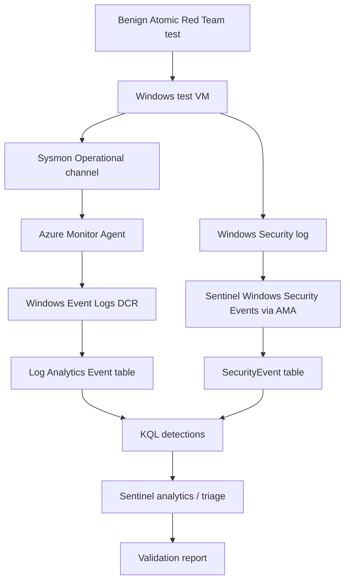

# Lab architecture

## Data paths

| Component | Role | Destination |
|---|---|---|
| Sysmon | Process, network, file, registry, DNS telemetry | Sysmon Operational event channel |
| Azure Monitor Agent + Windows Event Logs DCR | Collects the selected Sysmon channel and event IDs | `Event` table |
| Sentinel Windows Security Events via AMA connector | Collects configured Security log events | `SecurityEvent` table |
| KQL | Queries the table used by the corresponding collection path | Results / analytics rules |
| Atomic Red Team | Executes a controlled test on the lab VM | Evidence captured by the analyst |

Do not assume Sysmon events arrive in `SecurityEvent`, or that built-in rules querying `SecurityEvent` will query the generic `Event` table. Verify each path independently. Limit scope to one VM. The starter validation test is benign PowerShell command execution; no credential theft, persistence deployment, exploitation, or production testing is in scope.
